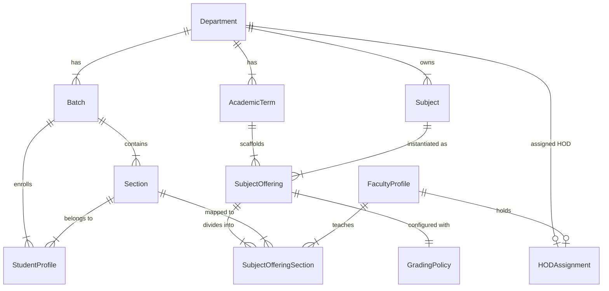

# Business Logic & System Architecture Specification (`logic.md`)

This document serves as the **living source of truth** for all business logic, architectural boundaries, data contracts, and scoping rules implemented across the Internal Assessment Marks & Attendance Management System.

---

## 1. Roles & Scoping

| Role | Scope Boundaries | Permissions & Rules |
| :--- | :--- | :--- |
| **`ADMIN` (System Administrator)** | Institute-Wide (Structural Only) | • Manages Departments (Programs) and total semester bounds. • Creates Academic Batches and scaffolds initial section structures. • Onboards Faculty members and assigns/replaces HODs. • Manages Student Directory and sets/clears repeater `semesterOverride`. • **Strict Boundary**: Cannot view/configure grading policies, enter marks, or perform HOD department actions. |
| **`HOD` (Faculty + `HODAssignment`)** | Single Assigned Department | • Must hold an active `HODAssignment` record in PostgreSQL. • Manages Master Department Subjects (Name, Code, Semester Mapping). • Promotes batches belonging to their department. • Assigns Teaching Faculty to specific `SubjectOfferingSection` rows. • Configures, duplicates, and confirms `GradingPolicy` for Subject Offerings. • Receives escalated student queries (instruct-only; **cannot edit student marks directly**). |
| **`FACULTY` (Teaching Faculty)** | Assigned `SubjectOfferingSection` | • Assigned to specific section offerings by the department HOD. • Enters/edits student marks for their assigned section (generates `AuditLog`). • Uploads and commits section attendance CSVs (with slab validation). • First-line responder for student discrepancies/queries. • **Locking Enforcement**: Marks and attendance entry blocked (`HTTP 423 Locked`) until section is unlocked. |
| **`STUDENT` (Enrolled Student)** | Own Enrolled Batch & Section | • Read-only view of current semester subject performance, component breakdown, weighted totals, and live charts. • Effective semester derived from `semesterOverride` (if set) or batch `currentSemester`. • Downloads official PDF Mark Sheets. • Raises queries/discrepancies for enrolled subjects. |

---

## 2. Structural Model

1. **Department (Program)**:
   - Represents an academic department/program (e.g. BCA, MCA).
   - Holds `totalSemesters` (e.g., 6 for BCA, 4 for MCA; never hardcoded).

2. **Batch**:
   - Tied to a `Department` with a `startYear` and a `currentSemester`.
   - Promoted via whole-batch action (by Admin or department HOD).
   - Student repeater cases use `semesterOverride` on individual `StudentProfile` records without removing the student from their batch.

3. **Section**:
   - Belongs to a specific `Batch` (`Section.batchId` $\rightarrow$ `Batch.id`). Multiple sections (e.g. `M`, `AFT`, `B`) can coexist under the same batch.
   - Assigned to students during onboarding/import.
   - Admin can add new named sections to an existing batch (`POST /api/admin/batches/:id/sections`). Creating a section automatically scaffolds `SubjectOfferingSection` rows (`facultyId: null`, UNASSIGNED) for all subjects in the batch's current semester.
   - Section "M" of Batch 2024-27 (`id: sec-101`) and Section "M" of Batch 2025-28 (`id: sec-202`) have distinct primary keys.

4. **Subject**:
   - Master catalog item belonging to a `Department` with a code, name, and target `semesterNumber`.
   - Created and managed exclusively by the department HOD (`POST /api/hod/subjects`).

5. **AcademicTerm**:
   - Created or reused per `Department` + `semesterNumber` + `label` (e.g. `AY2025-26`) when a batch is created or promoted.

6. **SubjectOffering**:
   - An instance of a `Subject` within a specific `AcademicTerm`.
   - Owns the `GradingPolicy` (shared across all sections of that subject in that term).

7. **SubjectOfferingSection**:
   - Ties a specific `Section` (from a specific `Batch`) to a `SubjectOffering` and an assigned `FacultyProfile`.
   - **Correct Teaching Scope**: Faculty assignment is strictly per `SubjectOfferingSection` (`(subjectOfferingId, sectionId)`). Different sections of the same subject (across the same or different batches) have independent `SubjectOfferingSection` rows and independent faculty assignments.

---

## 3. Grading Policy Engine & Section Locking

1. **Policy Structure**:
   - Configurable per `SubjectOffering` by the HOD.
   - Contains:
     - `cesGroupWeightage`: Weightage for Continuous Evaluation Scheme.
     - `internalWeightage`: Weightage for Internal Exam.
     - `attendanceWeightage`: Weightage for Attendance.
     - `scoreComponents`: Array of components (Group `CES` or `INTERNAL`, name, maxMarks, order).
     - `attendanceSlabRanges`: Array of percentage ranges (`minPercent` to `maxPercent`) mapped to slab marks.
   - **Total IA Marks**: Dynamically calculated as `cesGroupWeightage + internalWeightage + attendanceWeightage` (never hardcoded).

2. **Policy Confirmation & Lock Rules**:
   - HODs can pre-fill a policy using "Duplicate Last Term" (`POST /api/hod/subject-offerings/:id/policy/duplicate-last-term`), which copies component definitions and attendance slabs from the previous term's offering.
   - Duplicated policies must still be explicitly confirmed (`POST /api/hod/subject-offerings/:id/policy/confirm`).
   - **Locking & Auditability**: Once a policy is confirmed (`confirmedAt !== null`), direct edits via `POST /api/hod/subject-offerings/:id/policy` are BLOCKED (`HTTP 400 POLICY_LOCKED`). To edit a confirmed policy, the HOD must explicitly call `POST /api/hod/subject-offerings/:id/policy/unconfirm` to unlock it. Every confirmation and unconfirmation creates an immutable `AuditLog` entry (`entityType: "GradingPolicy"`, `action: "CONFIRMED"` or `"UNCONFIRMED"`).

3. **Section Locking Enforcement (`HTTP 423 Locked`)**:
   - A `SubjectOfferingSection` is **LOCKED** if:
     1. No faculty member is assigned (`facultyId === null`), **OR**
     2. The `GradingPolicy` has not been confirmed (`confirmedAt === null`).
   - While LOCKED, any attempt by faculty to enter marks (`PUT /api/marks/bulk`) or commit attendance (`POST /api/sections/:id/attendance/commit`) is rejected by server middleware with **`HTTP 423 Locked`**.

---

## 4. Attendance Management

1. **CSV Import Specs**:
   - Imported per Faculty for their assigned `SubjectOfferingSection`.
   - Expected CSV Format: `ERP / PRN, Student Name, Attendance Percentage` (plain numeric percentage e.g. `85 border-slate-200`, no `%` suffix).

2. **Dry-Run Preview & Slab Gap Enforcement**:
   - Dry-run endpoint (`POST /api/sections/:id/attendance/preview`) parses the CSV and evaluates each student's attendance percentage against the confirmed policy's `attendanceSlabRanges`.
   - **Status Mapping**:
     - `READY`: Percentage falls cleanly inside an existing slab range.
     - `BLOCKED_SLAB_GAP`: Percentage falls in a gap between defined slabs.
     - `UNMATCHED`: Student ERP/PRN not found in the section.
   - Committing attendance (`POST /api/sections/:id/attendance/commit`) rejects the import if any row contains `BLOCKED_SLAB_GAP` or `UNMATCHED`.

3. **Overwrite Contract**:
   - Committing attendance upserts the `AttendanceRecord` for `(subjectOfferingSectionId, studentId)`. Latest upload overwrites existing percentages. No snapshot history is maintained.

---

## 5. Marks Entry & Audit Logging

1. **Ownership Requirement**:
   - Only the assigned teaching faculty (`facultyId` matching `req.user.facultyId`) can enter or update marks for a section. Non-assigned faculty attempts are rejected with `HTTP 403 TEACHING_FACULTY_ONLY`.

2. **Server-Side Bounds Validation (`HTTP 400 MARK_OUT_OF_BOUNDS`)**:
   - `PUT /api/marks/bulk` validates every entry: `marksObtained` must be numeric and satisfy `0 <= marksObtained <= scoreComponent.maxMarks`.
   - Submissions exceeding `maxMarks` or below `0` are rejected prior to database transaction with `HTTP 400 Bad Request` (`code: MARK_OUT_OF_BOUNDS`).

3. **Frontend Numeric Input UX & Safety**:
   - All numeric inputs across the application (Marks Grid, Policy Builder weightages/components/slabs, Department/Batch semester bounds) enforce HTML `min` and `max` attributes matching valid ranges.
   - Live inline validation flags out-of-bounds cells with a red border (`border-rose-500 bg-rose-50`) and disables save buttons until fixed.
   - Up/down spinner arrows are hidden globally via CSS (`-webkit-appearance: none`, `-moz-appearance: textfield`).
   - Mouse scroll-wheel value modifications are prevented via `onWheel={(e) => (e.target as HTMLElement).blur()}`.

4. **Inline Attendance Editing & Slab Gap Enforcement (`HTTP 400 BLOCKED_SLAB_GAP`)**:
   - `PUT /api/marks/bulk` accepts `attendanceEntries` alongside component marks.
   - Attendance percentage must satisfy `0 <= attendancePercent <= 100`.
   - Reuses `attendanceScore` from `gradingEngine.ts` to perform slab range lookups: if the entered percentage falls in an unmapped slab gap, the request is rejected with `HTTP 400 Bad Request` (`code: BLOCKED_SLAB_GAP`).
   - Overwrites existing `AttendanceRecord` for `(subjectOfferingSectionId, studentId)` (consistent with latest-overwrites policy).
   - Recomputes Total IA live on the frontend table grid.

5. **Audit Logging**:
   - Every single mark creation or modification creates an immutable `AuditLog` entry recording `entityType: "Mark"`, `entityId`, `changedByUserId`, `oldValue`, `newValue`, and timestamp.
   - Every manual attendance percentage modification creates an immutable `AuditLog` entry recording `entityType: "AttendanceRecord"`, `entityId`, `changedByUserId`, `oldValue` (e.g. `"70%"` or `"NEW_ENTRY"`), `newValue` (e.g. `"85%"`), and timestamp.

---

## 6. Student Queries & Grievance Workflow

1. **Lifecycle**:
   - **Student**: Submits query for a subject offering section (`status: OPEN`).
   - **Faculty (First Line)**: Receives query in inbox. Can post thread messages (`POST /api/queries/:id/messages`) and resolve the issue (`status: RESOLVED`).
   - **HOD Escalation**: If unresolved, query can be escalated to HOD (`status: ESCALATED`).

2. **HOD Grievance Boundary**:
   - HODs receive escalated queries and can post instruction messages to the thread.
   - **Strict Rule**: HODs cannot edit student marks directly. All mark corrections must be performed by the assigned teaching faculty for that section.

---

## 7. Authentication & Security

1. **Credentials & Onboarding**:
   - No self-registration.
   - Usernames: ERP Number (Students), Employee ID (Faculty / HOD / Admin).
   - Passwords: Randomly generated during onboarding (excluding ambiguous characters like `0`, `O`, `1`, `l`), hashed via `bcrypt`. No forced password rotation.
   - Admin credential export available as Excel sheets (`.xlsx`).

2. **Account Lockout**:
   - 10 consecutive failed login attempts lock the account for 24 hours (`MAX_FAILED_LOGIN_ATTEMPTS = 10`).
   - Login endpoint returns `HTTP 423 Locked` with options `['request-password-reset', 'wait-24h']`.
   - Admin/HOD can force-reset user passwords.

3. **Profile Settings**:
   - Role-agnostic profile endpoints (`GET /api/profile/me`, `PUT /api/profile/me`, `POST /api/profile/change-password`).
   - Name updates persist to `StudentProfile.name` or `FacultyProfile.name` (with upsert fallback for Admin accounts) and return `displayName`.

---

## 8. Known Deferred Items

1. **Student Bulk-Import**: Pending user specification of CSV format.
2. **SMS Password Reset**: Out of scope (email reset & force-reset only).
3. **Attendance Snapshot History**: Intentionally omitted; latest upload overwrites.

---

## 9. Codebase Conformance Audit & Discrepancy Log

### Explicit Verification Evidence by Area

| Feature Area | Specification Contract | Current Codebase Implementation & Verification Evidence | Status |
| :--- | :--- | :--- | :--- |
| **1. Admin Boundary** | Structural only (Departments, Batches, Onboarding, Overrides); no policy or mark edits. | Verified in `adminRoutes.ts` & `adminController.ts`. `adminRoutes.ts` mounts only `/departments`, `/batches`, `/faculty`, `/students`. No policy/mark handlers exist on `adminRoutes`. | **CONFORMS** |
| **2. HOD Scoping** | Must hold `HODAssignment` for target department. | Verified in `auth.ts` (`requireHODOfDepartment`) & `hodRoutes.ts`. Checked against DB table `HODAssignment`. Cross-department actions reject with `403 HOD_DEPARTMENT_MISMATCH`. | **CONFORMS** |
| **3. Faculty Ownership** | Only assigned teacher for a section can edit marks. | Verified in `marksController.ts` (`bulkUpsertMarks`) & `attendanceController.ts` (`commitAttendanceImport`). Rejects non-assigned faculty with `403 TEACHING_FACULTY_ONLY`. | **CONFORMS** |
| **4. Section Faculty Assignment** | Scoped per `SubjectOfferingSection` (`(offeringId, sectionId)`). | Verified in `hodController.ts` (`assignFacultyToSection`). Updates strictly the target section. Multi-batch sections sharing a term remain independent. | **CONFORMS** |
| **5. Policy Engine & Weightages** | Dynamic CES, Internal, Attendance weightages & slab ranges. | Verified in `gradingEngine.ts` & `policyController.ts` (`upsertGradingPolicy`). Calculates live total IA marks from component sums. | **CONFORMS** |
| **6. Section Lock Enforcement** | Unassigned faculty or unconfirmed policy blocks entry (`423`). | Verified in `lock.ts` (`requireUnlockedSection`). Evaluated on `PUT /api/marks/bulk` and `POST /api/sections/:id/attendance/commit`. | **CONFORMS** |
| **7. Attendance Slab Gap Validation** | Dry-run flags `BLOCKED_SLAB_GAP`; commit rejects invalid slab ranges. | Verified in `attendanceController.ts` (`previewAttendanceImport` & `commitAttendanceImport`). | **CONFORMS** |
| **8. Audit Logging** | Log every mark edit with old/new value, user, timestamp. | Verified in `marksController.ts` (`bulkUpsertMarks`). Writes `AuditLog` records for every created/updated mark. | **CONFORMS** |
| **9. Grievance Workflow** | Student $\rightarrow$ Faculty $\rightarrow$ Escalated HOD (instruct-only). | Verified in `queryController.ts` (`addQueryMessage`, `escalateQuery`, `resolveQuery`). HOD cannot bypass marks ownership. | **CONFORMS** |
| **10. Account Lockout** | 5 consecutive failed logins lock account for 24h. | Verified in `authService.ts` (`login`). Returns `423` with reset/wait options when `failedAttempts >= 5`. | **CONFORMS** |
| **11. Profile Name Persistence** | Persists displayName for Admin, Faculty, HOD, and Student accounts. | Verified in `profileController.ts` (`updateProfile`). Upserts `FacultyProfile` for Admin users; updates `FacultyProfile`/`StudentProfile` for others. | **CONFORMS** |

### Historical Discrepancy Log (Discovered & Resolved)

1. **New Batch Section Scaffolding Gap (Fixed)**:
   - *Initial State*: Calling `createBatch` created a `Batch` row, but omitted Section creation and Semester 1 `SubjectOfferingSection` scaffolding.
   - *Fix Applied*: Updated `createBatch` in `adminController.ts` to auto-create Section "A" and scaffold `SubjectOfferingSection` rows with `facultyId: null` (**UNASSIGNED**) for all Semester 1 subjects.

2. **Admin Profile Name Persistence Gap (Fixed)**:
   - *Initial State*: Admin accounts (`ADMIN001`) have no `FacultyProfile` or `StudentProfile`, causing `updateProfile` to update 0 rows and return the old username on page reload.
   - *Fix Applied*: Updated `updateProfile` in `profileController.ts` to perform a `prisma.facultyProfile.upsert` for `ADMIN` role users.

3. **Faculty Route Mounting Precedence Bug (Fixed)**:
   - *Initial State*: `app.use("/api", facultyRoutes)` in `app.ts` was mounted before `profileRoutes`, causing top-level `requireAuth([Role.FACULTY])` to reject non-faculty profile updates with `403`.
   - *Fix Applied*: Reordered route mounts in `app.ts` so specific sub-resources (`/api/profile`, `/api/admin`, `/api/hod`, `/api/students`) are mounted before broad catch-all routes.

4. **HOD Post-Login Routing Bug (Fixed)**:
   - *Initial State*: `page.tsx` routed all `Role.FACULTY` users to `/faculty`, preventing HODs from landing on `/hod`.
   - *Fix Applied*: Updated `AuthService.login` to return `isHOD` flag and updated `page.tsx` to route `isHOD === true` users directly to `/hod`.

5. **Multi-Section Batch Scaffolding & Seed Gap (Fixed)**:
   - *Initial State*: Batches supported only a single auto-created section with no endpoint to add additional sections mid-semester. Furthermore, seed data created section `AFT` but did not scaffold it into `SubjectOfferingSection` rows.
   - *Fix Applied*: Added `POST /api/admin/batches/:id/sections` in `adminController.ts` with automatic subject offering section scaffolding for the batch's current semester. Updated `seed.ts` to scaffold `AFT` into `SubjectOfferingSection` rows for BCA101 and BCA102. Added "+ Add Section" button in Admin UI (`admin/page.tsx`).

6. **Mid-Term Subject Creation Scaffolding Gap (Fixed)**:
   - *Initial State*: Creating a new subject via `createSubject` created the master subject row, but omitted scaffolding `SubjectOffering` and `SubjectOfferingSection` rows for active batches in that semester.
   - *Fix Applied*: Updated `createSubject` in `hodController.ts` to query active batches in `semesterNumber`, get/create `AcademicTerm` and `SubjectOffering`, and scaffold `SubjectOfferingSection` rows (`facultyId: null`, **UNASSIGNED**).

7. **Repeater Roster & Attendance Roster Scope Leak (Fixed)**:
   - *Initial State*: Section student roster queries in `marksController.ts` (`getSectionMarksGrid`) and `attendanceController.ts` (`previewAttendanceImport`) fetched all students enrolled in the section without verifying whether the student's `semesterOverride` matched the subject offering's semester.
   - *Fix Applied*: Added effective semester filtering (`effectiveSem === offeringSem`) to `marksController.ts` and `attendanceController.ts`.

8. **Confirmed Grading Policy Silent Mutability Gap (Fixed)**:
   - *Initial State*: HODs could directly modify component definitions, weightages, and attendance slabs on a confirmed policy without an audit trail or explicit unlock step.
   - *Fix Applied*: Blocked direct updates on confirmed policies (`HTTP 400 POLICY_LOCKED`), added `POST /api/hod/subject-offerings/:id/policy/unconfirm` endpoint, and added `AuditLog` creation for `CONFIRMED` and `UNCONFIRMED` actions.

9. **Faculty Assigned Sections Dropdown Fallback Bug (Fixed)**:
   - *Initial State*: `/faculty` was calling `GET /api/hod/subject-offerings?departmentId=dept-bca` (a hardcoded HOD endpoint) instead of fetching the logged-in faculty member's specific section assignments.
   - *Fix Applied*: Added `GET /api/faculty/my-sections` in `marksController.ts` & `facultyRoutes.ts`. Updated `faculty/page.tsx` to call `/api/faculty/my-sections`, correctly displaying all section offerings assigned to that faculty member (`BCA101 - Section M`, `BCA101 - Section AFT`, etc.).

10. **Attendance Slab Builder & Validation UI Gap (Fixed)**:
    - *Initial State*: The Policy Builder modal on `/hod` lacked a slab range table for editing `AttendanceSlabRange` rows (`minPercent` to `maxPercent` -> `marks`), omitting slab editing and coverage/overlap warnings.
    - *Fix Applied*: Built Attendance Slab Ranges table in `frontend/src/app/hod/page.tsx` with `openPolicyModal` pre-filling existing slab records, add/remove row controls, and a live client-side validation engine checking for overlaps, gaps (0-100% coverage), and weightage overflows.

11. **Faculty Attendance CSV File Input Gap (Fixed)**:
    - *Initial State*: `/faculty` required manual text copy-pasting into a `<textarea>` to import attendance CSV snapshots.
    - *Fix Applied*: Added a `<input type="file" accept=".csv">` file picker in `frontend/src/app/faculty/page.tsx` using browser `FileReader` to read CSV contents directly into the dry-run preview engine.

---

## 10. Security Model & Defense-in-Depth Protections

### Layer 1: Client-Side UX Route Guards
- **Pages Guarded**: `/admin`, `/hod`, `/faculty`, `/student`.
- **Implementation**: On component mount (`useEffect`), verifies the presence of valid `token` and `userData` in `localStorage`. Verifies role matches expected role (`ADMIN`, `FACULTY` + HOD assignment for HOD, `FACULTY` for faculty, `STUDENT` for student). Redirects unauthorized attempts to `/` immediately.

### Layer 2: Server-Side Authorization & IDOR Boundaries
- **Role Enforcement**:
  - `PUT /api/marks/bulk` & `POST /api/sections/:id/attendance/commit`: Enforces `requireAuth([Role.FACULTY])` and `requireUnlockedSection` middleware.
  - `GET /api/reports/subject-offerings/:id/export`: Enforces `requireAuth([Role.ADMIN, Role.FACULTY])` (denies `Role.STUDENT` with `HTTP 403`).
  - HOD Routes (`/api/hod/*`): Enforces `requireAuth([Role.FACULTY])` and `requireHODOfDepartment`.
  - Admin Routes (`/api/admin/*`): Enforces `requireAuth([Role.ADMIN])`.
- **IDOR Safeguards**:
  - `GET /api/students/me/semester-view`: Reads `req.user.userId` from JWT payload; ignores client-supplied params.
  - `GET /api/reports/students/:studentId/subject-offerings/:offeringId/pdf`: Rejects requests where `req.user.role === Role.STUDENT` and `student.userId !== req.user.userId` (`code: IDOR_FORBIDDEN`).
  - Query Endpoints (`/api/queries/:id/messages`, `/api/queries/:id/escalate`, `/api/queries/:id/resolve`): Rejects requests from students attempting to post, escalate, or resolve queries belonging to other students (`code: IDOR_FORBIDDEN`).

### Layer 3: JWT Secret Hardening, Expiry & Production Fail-Safe
- **Production Guard**: At server boot (`app.ts`), if `NODE_ENV === "production"` and `JWT_SECRET` is unset or equals default fallbacks, server logs a fatal security error and immediately terminates (`process.exit(1)`). Removed stray default fallback strings across codebase.
- **Password Reset Expiry**: Password reset tokens are signed JWTs generated via `forgotPasswordHandler` with an **exact 15-minute expiration (`expiresIn: "15m"`)**. Expired reset tokens are rejected by `POST /api/auth/reset-password`.
- **Account Enumeration Safeguard**: `login` and `forgot-password` return generic non-enumerating messages (`"Invalid username or password"`, `"Password reset link sent to registered email if account exists."`).

### Layer 4: Input Sanitization, File Whitelisting & Size Limits
- **XSS Sanitization**: `sanitizeTextInput` (`sanitizer.ts`) escapes HTML entities (`&`, `<`, `>`, `"`, `'`, `/`) on text inputs (`createQuery`, `addQueryMessage`).
- **File Whitelisting**:
  - CSV Import (`attendanceController.ts`): Enforces 2MB size limit and header validation (`ERP`, `PRN`, `Attendance`); rejects invalid structures (`code: INVALID_CSV_STRUCTURE`).
  - Profile Pictures (`profileController.ts`): Validates Data URIs (`png`/`jpeg`/`webp`) or HTTPS image URLs (`.png`, `.jpg`, `.jpeg`, `.webp`); rejects executable URLs (`code: INVALID_IMAGE_TYPE`).
- **Payload Limits**: Express app enforces a strict **2MB body size limit** (`express.json({ limit: "2mb" })`) in `app.ts`.
- **Crawler Protection**: `frontend/public/robots.txt` disallows all web crawlers (`Disallow: /`).

### Layer 5: CORS Configuration
- **Allowed Origins**: Strictly configured in `app.ts` via `cors()` middleware with `FRONTEND_URL` and authorized origin list (`http://localhost:3000`, `http://localhost:3001`). Rejects unauthorized origins with CORS policy violation errors.

### Layer 6: Rate Limiting & Audit Trail
- **Auth Lockout**: 10 failed consecutive password attempts lock account for 24 hours (`MAX_FAILED_LOGIN_ATTEMPTS = 10` in `AuthService`).
- **Endpoint Rate Limiting**: `generalRateLimiter` enforces 300 requests per 15-minute sliding window on `/api`; `authRateLimiter` enforces 25 login requests per 15 minutes (buffering up to 10 failed login retries).
- **Expanded Audit Logging**: Security audit events (`AUTH_LOCKOUT`, `PASSWORD_CHANGED`, `FORCE_PASSWORD_RESET`) are logged to the `AuditLog` table.
- **Admin Password Rotation**: In production (`NODE_ENV === "production"`), `seed.ts` reads `ADMIN_INITIAL_PASSWORD` or generates a random 16-character password via `crypto.randomBytes(12)`, outputting initial credentials to stdout ONCE.
